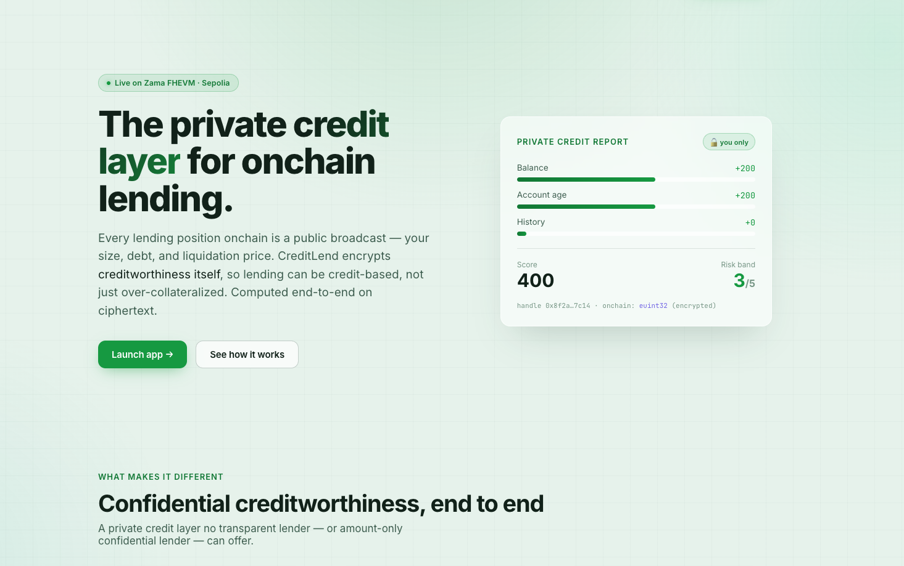

# CreditLend — Confidential No-Loss Prize Savings, powered by Confidential Credit Lending

> **🔐 Submission — Build the Confidential PoolTogether App · [Zama Developer Program](https://github.com/zama-ai/fhevm)**
>
> *"A prize-savings protocol on a transparent chain leaks everything: how much every user saved, each wallet's odds of winning, and who won every draw. That turns savers into targets and makes 'fair' unprovable. CreditLend rebuilds PoolTogether under Fully Homomorphic Encryption — and goes one step further than the brief: the prize is not a mock, it's **real yield from a confidential lending market**. Deposits are lent to private borrowers, the encrypted interest they pay is the prize, and one saver wins it through a provably-fair on-chain FHE draw. Balances, odds, yield, and the winner all stay encrypted. Principal is never at risk."*

A fully on-chain, no-loss prize-savings protocol — deposit, get lent out, win the yield, withdraw any time — where every sensitive value is encrypted using Fully Homomorphic Encryption (FHE) via [fhEVM](https://github.com/zama-ai/fhevm) by Zama. Two confidential protocols compose into one loop:

```
Savers ──deposit(enc)──▶ PrizePool ──supply(enc)──▶ LendingPool ──lends──▶ Borrowers
   ▲                        (euint64 balances)          │                     │
   │                                                    │  encrypted interest  │
   └──── wins the PRIZE ◀── FHE draw ◀──── harvest yield ◀──────────────────────┘
             (one saver, privately)     (reserve − principal, on ciphertext)
```

## Demo

[](https://youtu.be/02gblniRlwQ)

Deposit sizes, pool shares, odds, borrower collateral/debt, the harvested yield, the random draw ticket, and the winner are all stored as encrypted ciphertexts. The EVM computes over them without ever seeing the plaintext — only the winner learns they won, by decrypting their own balance.

---

## Problems We Solve

On-chain prize savings are broken by default. Everything you submit is public — your deposit, your share, your odds, and the winner of every draw. This creates a class of problems that are impossible to prevent on transparent blockchains:

### 1. Wealth Surveillance

On PoolTogether-style protocols, every deposit is a public number. Anyone can rank savers by balance and target the largest. With FHE:
- Deposits and balances are `euint64` ciphertexts — observers see `bytes32` handles, not amounts.
- Only you can decrypt your own balance, through the EIP-712 user-decryption flow.

### 2. Odds Leakage

If balances are public, so are the odds — everyone can compute each wallet's exact probability of winning. With FHE:
- Your share of the pool is never revealed; the pool total is disclosed **only at a draw**, and only in aggregate.
- No individual balance is ever exposed, so nobody can compute your odds.

### 3. Unfair / Manipulable Draws

Off-chain RNG can be rigged, and block-derived randomness can be gamed by the party that triggers the draw. With FHE:
- Winners are selected on-chain with `FHE.randEuint64` — encrypted randomness from the Zama coprocessor, not block data.
- The draw runs over **encrypted** balances; the random ticket itself is a ciphertext. The fulfiller cannot bias it.

### 4. Winner Doxxing

A public winner is a public target — a fresh whale for scammers and phishers. With FHE:
- The prize is credited directly to the winner's **encrypted** balance; no winner address is ever published.
- Only the winner learns the outcome, by decrypting their own balance. Even the protocol can't see who won.

### 5. Yield Opacity — "is the prize even real?"

Mock prizes require trusting an admin. A real yield source usually means exposing every borrower's position. With FHE:
- The prize is genuine lending interest, harvested homomorphically as `reserve − suppliedPrincipal`.
- Borrowers' collateral, debt, and rate stay encrypted end-to-end, yet the yield is provably real and on-chain.

---

## Token Standard — ERC-7984

All value in this protocol moves as [ERC-7984](https://eips.ethereum.org/EIPS/eip-7984) confidential tokens (via OpenZeppelin's [confidential-contracts](https://github.com/OpenZeppelin/openzeppelin-confidential-contracts)). ERC-7984 is an encrypted-balance token standard (analogous to ERC-20, but for fhEVM) where:

- **Balances are `euint64` ciphertexts** — the chain never sees a plaintext amount.
- **Transfers are encrypted** — `confidentialTransfer` and `confidentialTransferAndCall` carry encrypted handles, not values.
- **`IERC7984Receiver`** — `PrizePool` and `LendingPool` accept confidential deposits via `onConfidentialTransferReceived`; the deposit's target (market id / prize flag) rides in the ERC-7984 `data` field.

`cUSDC` is the savings asset (and the markets' debt token); `cWETH`/`cWBTC`/`cLINK`/`cEUR` are borrower collateral. Payouts and redemptions move ciphertext via `confidentialTransfer`, clamped to the caller's encrypted balance so an over-withdraw never reverts or leaks. A production build wraps real ERC-20s at 1:1 into ERC-7984 with OZ's `ERC7984ERC20Wrapper`.

---

## Contracts (Sepolia)

Deployer: [`0x204a73e8303F3d09B12062dEdAA74B1CDA6E167d`](https://sepolia.etherscan.io/address/0x204a73e8303F3d09B12062dEdAA74B1CDA6E167d) · Network: fhEVM on Sepolia (chainId 11155111) · all verified

| Contract | Description | Address |
|---|---|---|
| `PrizePool.sol` | Confidential no-loss prize savings — encrypted deposits, FHE draw, no-loss withdraw, harvests lending yield. | [0x91123C…C0243](https://sepolia.etherscan.io/address/0x91123C3C4Fe50F3fe5ADCF209D73a75F8D5C0243) |
| `LendingPool.sol` | Confidential multi-market lending + supplier side (`supply`/`redeem`/`recognizeYield`) that turns interest into the prize. | [0x9D2ae3…2718A](https://sepolia.etherscan.io/address/0x9D2ae3888C540485eEf3c94be2C6842b1F92718A) |
| `CreditOracle.sol` | Encrypted credit score → risk band (1–5) for borrowers. | [0x438301…fCFaE](https://sepolia.etherscan.io/address/0x438301dE2Ec1D1803bc3e103848c1ded000fCFaE) |
| `InterestRateModel.sol` | Encrypted, band-priced borrow rate (kept encrypted end-to-end). | [0xf5B8D0…4C366](https://sepolia.etherscan.io/address/0xf5B8D05d79629a9F0C0C015Eda1c07514954C366) |
| `RepaymentTracker.sol` | Encrypted repayment reputation → unsecured credit line. | [0xAF3D31…31842](https://sepolia.etherscan.io/address/0xAF3D317d6C22f95fb2076f42414fB44639E31842) |
| `PositionManager.sol` | Encrypted per-market borrower positions (collateral + debt). | [0xf9eAa5…6e234](https://sepolia.etherscan.io/address/0xf9eAa5471DCA15f8cABA54d09F207704c526e234) |
| `GuarantorModule.sol` | Confidential third-party backing (hidden guarantor + amount). | [0x941C2d…33A22](https://sepolia.etherscan.io/address/0x941C2dC714B7D625C3F97a0D58D02558A1233A22) |
| `LiquidationEngine.sol` | Epoch-batched liquidation; reveals only one health bit at the trigger. | [0x9C2fe9…1AeD8](https://sepolia.etherscan.io/address/0x9C2fe9507b75372bf01E8Fc95580edbaCC51AeD8) |
| `LiquidationAuction.sol` | Sealed-bid auction — encrypted bids, encrypted running-max winner. | [0x59AC92…eE70E](https://sepolia.etherscan.io/address/0x59AC9273467E78fC97C9d569FC3FDa51126eE70E) |
| `ComplianceViewer.sol` | Consent-based, scoped auditor decryption of a single handle. | [0xe27dd8…8137d](https://sepolia.etherscan.io/address/0xe27dd8f4f60bC67E14019Ec19071aAeb0798137d) |
| `ChainlinkFeedRegistry.sol` | On-chain `symbol→feed` registry, seeded with real Sepolia feeds. | [0x4b423F…3D92C](https://sepolia.etherscan.io/address/0x4b423F85b35E572BF02E621a127f5C420d43D92C) |
| `OracleAdapter.sol` | Single-feed Chainlink price wrapper (normalizes to a pool scalar, staleness guard). One per USD market (4 deployed; cEUR→cUSDC shown). | [0x046744…8569E](https://sepolia.etherscan.io/address/0x046744350dC137b30e20Cfdc7673d70359F8569E) |
| `PairPriceOracle.sol` | Cross-asset price from two USD feeds (collateral/USD ÷ debt/USD). One per cross-asset market (2 deployed). | [0x002970…3c870](https://sepolia.etherscan.io/address/0x002970C4034860d6C394d5618c09E7914313c870) |
| `MockConfidentialUSDT.sol` (`cUSDC`) | ERC-7984 savings asset + markets' debt token. Mintable faucet. | [0xC6c91e…da67d](https://sepolia.etherscan.io/address/0xC6c91ef5645eA7C6Eb7638B8ba259374731da67d) |

Collateral tokens: [cWETH](https://sepolia.etherscan.io/address/0x6C51168dE1271eb2B93c601C6158720145707d3e) · [cWBTC](https://sepolia.etherscan.io/address/0x9f822D7A5CE92e40c621E96CAd05aE380970B051) · [cLINK](https://sepolia.etherscan.io/address/0x4C8Aea5e31fF3577EaDC16EE77B91Fc1a1D5d5C9) · [cEUR](https://sepolia.etherscan.io/address/0xCe78ac4Ae26f9f4E236e97762f04d11203Fa177E). **6 markets** (4 USD + 2 cross-asset) priced by real Chainlink feeds; **cEUR→cUSDC** (id 3) is the yield/demo market.

---

## Live Transactions (Sepolia)

The full end-to-end loop is verified live on Sepolia by [`scripts/live-check.ts`](scripts/live-check.ts) (real txs + encrypted inputs via the relayer):

| Action | Function | Result |
|---|---|---|
| Deposit cUSDC (encrypted) → pool supplies it to the lending market | `confidentialTransferAndCall` → `supply` | encrypted balance = 5000 ✓ |
| Inject + recognize real lending interest as the prize | `harvest` → `recognizeYield` | yield harvested on ciphertext ✓ |
| Reveal aggregate total, then draw the winner on ciphertext | `requestDraw` → `fulfillDraw` | `FHE.randEuint64` winner credit ✓ |
| Decrypt winnings (winner-only) | `balanceOf` + user-decrypt | balance = 5300 (won the yield) ✓ |
| No-loss withdraw of principal + winnings | `withdraw` → `redeem` | balance = 0, tokens returned ✓ |

> Run it yourself: `npx hardhat run scripts/live-check.ts --network sepolia`.

---

## Encrypted Fields at a Glance

| Field | Contract | Type | Privacy Benefit |
|---|---|---|---|
| Saver deposit / balance | `PrizePool` | `euint64` | **Most critical** — hides each saver's wealth and their odds |
| Pool share / winnings | `PrizePool` | `euint64` | Winner-only reveal — nobody sees who won |
| Random draw ticket | `PrizePool` | `euint64` | Draw can't be predicted or biased |
| Supplied principal | `LendingPool` | `euint64` | Hides pool liquidity size |
| Harvested yield | `LendingPool` | `euint64` | Prize amount stays private until awarded |
| Credit score / risk band | `CreditOracle` | `euint32` / `euint8` | Borrower creditworthiness never leaks |
| Borrow rate | `InterestRateModel` | `euint32` | Prevents rate-inversion recovery of the band |
| Collateral / debt (per market) | `PositionManager` | `euint64` | Hides borrower leverage & liquidation distance |
| Guarantor stake | `GuarantorModule` | `euint64` | Hides who backs whom, and how much |
| Liquidation bid / winner | `LiquidationAuction` | `euint64` / `eaddress` | Sealed-bid — no front-running |

---

## How Winner Selection Works — fair *and* confidential

The heart of the protocol. Winners are deposit-weighted (bigger deposit → better odds), selected with **on-chain FHE randomness** over **encrypted balances**, revealing nothing but the aggregate total.

`requestDraw()` reveals only the aggregate pool total — the single, documented leak, needed because `FHE.rem` takes a plaintext modulus — and freezes the pool. Then `fulfillDraw()` selects the winner entirely on ciphertext:

```solidity
// encrypted random ticket, uniform in [0, total) — on-chain randomness, no off-chain RNG
euint64 target = FHE.rem(FHE.randEuint64(), totalPlain);

euint64 cum   = FHE.asEuint64(0);
ebool   found = FHE.asEbool(false);
for (uint256 i = 0; i < depositors.length; i++) {
    address d = depositors[i];
    cum = FHE.add(cum, _balance[d]);                        // encrypted running sum
    ebool crossed  = FHE.gt(cum, target);                  // did we cross the ticket here?
    ebool newlyWon = FHE.select(found, FHE.asEbool(false), crossed); // (NOT found) AND crossed
    _balance[d] = FHE.add(_balance[d], FHE.select(newlyWon, prize, FHE.asEuint64(0))); // winner-only credit
    found = FHE.or(found, crossed);
}
```

Because the cumulative sum is monotonic and the ticket lies in `[0, total)`, **exactly one** depositor crosses it first, and `P(win) = balance_i / total` exactly. The prize is credited to that one **encrypted** balance — no `eaddress`, no winner address is ever published.

---

## FHE Highlights

### Real yield, harvested on ciphertext

```solidity
// LendingPool.recognizeYield — yield = max(reserve - suppliedPrincipal, 0), all encrypted
euint64 reserve   = debtToken.confidentialBalanceOf(address(this));
euint64 principal = _suppliedPrincipal;
euint64 yield     = FHE.select(FHE.gt(reserve, principal), FHE.sub(reserve, principal), FHE.asEuint64(0));
_suppliedPrincipal = FHE.add(principal, yield); // reclassify interest as principal (backs the prize)
```

Borrowers repay principal + interest → the pool's reserve grows above the supplied principal → that growth **is** the harvestable prize. No plaintext amounts are ever exposed.

### No-loss withdraw — clamp, never revert

```solidity
// PrizePool.withdraw — clamp to the caller's balance on ciphertext (an over-withdraw can't leak it)
euint64 amt  = FHE.select(FHE.le(req, bal), req, bal);
euint64 paid = lending.redeem(amt);        // pull principal back from the lending market
_balance[msg.sender] = FHE.sub(bal, paid); // settle against what was actually paid
```

### Deposit → supply, in one confidential callback

```solidity
// PrizePool.onConfidentialTransferReceived — credit the saver, then lend the liquidity out
_balance[from]  = FHE.add(_balance[from], amount);
_totalDeposits  = FHE.add(_totalDeposits, amount);
if (address(lending) != address(0)) {
    FHE.allowTransient(amount, address(lending));
    lending.supply(amount);                // route liquidity into the lending market
}
```

### Reveal one bit, at the trigger — liquidation health

```solidity
// LendingPool._unhealthy — cross-multiplied comparison, no division, no plaintext
euint64 effBacking = FHE.add(_valued(marketId, _backing(marketId, user)), _creditLine(user));
return FHE.lt(FHE.mul(effBacking, lltv), FHE.mul(debt, uint64(10_000)));
```

---

## Architecture & Contract Flow

### System Overview

```
┌───────────────────────────────────────────────────────────────────┐
│                         Frontend (Next.js 15)                     │
│   @zama-fhe/react-sdk · wagmi/viem · MetaMask · Chainlink         │
└────────────────────────────┬──────────────────────────────────────┘
                             │ encrypted handles + inputProof
                             ▼
┌───────────────────────────────────────────────────────────────────┐
│                       Sepolia Testnet (fhEVM)                     │
│  ┌───────────┐  supply/redeem/harvest  ┌────────────────────┐     │
│  │ PrizePool │◄───────────────────────►│    LendingPool     │     │
│  │  (savers) │   draw · FHE.randEuint64│  (6 markets)       │     │
│  └───────────┘                         └───┬───────┬────────┘     │
│                                            │       │              │
│   ┌──────────────┐  ┌──────────────┐  ┌────▼──┐ ┌──▼─────────┐    │
│   │ CreditOracle │  │ RateModel    │  │Liquid.│ │ Guarantor  │    │
│   │ RepaymentTr. │  │ PositionMgr  │  │Engine+│ │ Compliance │    │
│   └──────────────┘  └──────────────┘  │Auction│ └────────────┘    │
│                                       └─┬─────┘                   │
│   ┌──────────────────────┐  ┌───────────▼───┐  ┌───────────────┐  │
│   │ChainlinkFeedRegistry │─►│ OracleAdapter │  │   Zama KMS    │  │
│   └──────────────────────┘  └───────────────┘  │  (off-chain)  │  │
│                                                └───────────────┘  │
└───────────────────────────────────────────────────────────────────┘ 
```

### Flow 1 — Deposit (saver → lent out)

```
Saver
 ├─1─► useEncrypt({ value: amount, type: 'euint64' })         → { handle, inputProof }
 └─2─► cUSDC.confidentialTransferAndCall(prizePool, handle, inputProof, "0x")
            │
            ├─► PrizePool.onConfidentialTransferReceived(from, amount, "")
            │       _balance[from] += amount ; _totalDeposits += amount   (encrypted)
            │       register depositor
            └─► lending.supply(amount)         ← liquidity flows into the lending market
```

### Flow 2 — Borrow (the yield engine)

```
Borrower
 ├─► CreditOracle.submitInputs(encBalances, encAge, proof)     → encrypted score + band
 ├─► cWETH/cEUR.confidentialTransferAndCall(lendingPool, encColl, proof, marketId)
 └─► LendingPool.borrow(marketId, encAmount, proof)
            ├─► ratio = select(band)                          ← dynamic collateral ratio
            ├─► ok = valued(collateral)+creditLine >= amount*ratio/100   (all FHE)
            ├─► actual = select(ok, amount, 0)                ← clamp, never revert
            └─► debtToken.confidentialTransfer(borrower, actual)  ← from the pooled savings
      … interest accrues on the encrypted debt over time …
```

### Flow 3 — Harvest (interest → prize)

```
Admin / keeper
 └─► PrizePool.harvest()
        └─► LendingPool.recognizeYield()
                yield = max(reserve − suppliedPrincipal, 0)   (on ciphertext)
                _suppliedPrincipal += yield
                return yield  →  PrizePool._prizeReserve += yield
```

### Flow 4 — Draw (FHE-random, deposit-weighted)

```
Admin / keeper
 ├─STEP 1─► PrizePool.requestDraw()
 │              FHE.makePubliclyDecryptable(_totalDeposits)   ← reveal aggregate only
 │              freeze the pool ; emit DrawRequested(handle)
 │  [ Zama KMS decrypts the aggregate total off-chain ]
 └─STEP 2─► publicDecrypt(totalHandle) → { cleartexts, proof }
                 └─► PrizePool.fulfillDraw(cleartexts, proof)
                         FHE.checkSignatures(...)
                         target = FHE.rem(FHE.randEuint64(), total)
                         walk depositors → credit prize to the one winner (encrypted)
```

### Flow 5 — Claim & Withdraw (no loss)

```
Winner / saver
 ├─► PrizePool.balanceOf(me)  → user-decrypt (EIP-712)         ← see your winnings, privately
 └─► PrizePool.withdraw(encAmount, proof)
        amt  = select(req <= bal, req, bal)                    ← clamp to balance
        paid = lending.redeem(amt)                             ← pull principal back
        cUSDC.confidentialTransfer(me, paid)                   ← principal + winnings, no loss
```

### Key Design Principle — ACL Permissions

Every ciphertext must be explicitly granted to each address that needs to read it:

```solidity
FHE.allowThis(x);                 // this contract can use x in a later tx
FHE.allow(x, msg.sender);         // the user can decrypt x via the KMS
FHE.allowTransient(x, token);     // one-tx grant before a confidential transfer
```

Without `FHE.allow`, even the user cannot decrypt their own balance.

---

## Quick Start

### Prerequisites
- **Node.js** 20+
- A Sepolia wallet with test ETH

### Installation

```bash
# 1. install
npm install

# 2. compile + test (FHEVM mock)
npx hardhat compile
npx hardhat test                 # 62 passing

# 3. deploy the full integrated stack to Sepolia (needs .env: PRIVATE_KEY, SEPOLIA_RPC_URL, ETHERSCAN_API_KEY)
npx hardhat run scripts/deploy-full.ts --network sepolia

# 4. verify (bytecode-matched contracts auto-verify)
npx hardhat verify --network sepolia <PrizePool> <cUSDC>

# 5. live end-to-end check on Sepolia
npx hardhat run scripts/live-check.ts --network sepolia

# 6. frontend — copy deployments/sepolia.json → frontend/lib/deployment.json, then:
cd frontend && npm install && npx next start -p 3210   # → http://localhost:3210
```

On Vercel: set the project **Root Directory** to `frontend`. Addresses are baked into the build from `frontend/lib/deployment.json` — no address env vars. The only optional env var is `NEXT_PUBLIC_RPC_URL` (a **public** Sepolia RPC — never a secret key; it ships to the browser).

## Project Structure

```
├── contracts/
│   ├── PrizePool.sol               # confidential prize savings + lending integration
│   ├── LendingPool.sol             # confidential lending market + supplier side (yield engine)
│   ├── CreditOracle · InterestRateModel · RepaymentTracker · PositionManager
│   ├── GuarantorModule · LiquidationEngine · LiquidationAuction · ComplianceViewer
│   ├── OracleAdapter · PairPriceOracle · ChainlinkFeedRegistry
│   └── mocks/MockConfidentialUSDT.sol · MockAggregator.sol
├── test/  Integration.ts · PrizePool.ts · lending/*        (62 tests)
├── scripts/  deploy-full.ts · live-check.ts · keeper.ts · verify-all.ts
├── frontend/  Next.js 15 dApp (wagmi v2 + @zama-fhe/react-sdk)
│   └── app/  landing · /app dashboard · /app/prize · /app/draw · /app/borrow · …
└── hardhat.config.ts
```

## Available Scripts

| Script | Description |
|---|---|
| `npx hardhat compile` | Compile all contracts |
| `npx hardhat test` | Run all tests (62, FHEVM mock) |
| `npx hardhat run scripts/deploy-full.ts --network sepolia` | Deploy the full integrated stack |
| `npx hardhat run scripts/live-check.ts --network sepolia` | Live end-to-end check on Sepolia |

### Test Results

```
62 passing
  Integration.ts   supply → borrow → interest → harvest → draw → no-loss withdraw
  PrizePool.ts     deposits · no-loss withdraw · one-winner draw · prize conservation
  lending/*        scoring · borrow · accrual · liquidation · guarantors · oracles · compliance
```

---

## Deploy to Sepolia

```bash
# 1. env
#    PRIVATE_KEY, SEPOLIA_RPC_URL, ETHERSCAN_API_KEY in .env

# 2. deploy full stack + wire PrizePool as the cUSDC liquidity supplier + faucet
npx hardhat run scripts/deploy-full.ts --network sepolia

# 3. sync the frontend
cp deployments/sepolia.json frontend/lib/deployment.json
```

### Verify a live Chainlink feed on Sepolia

```bash
cast call 0x694AA1769357215DE4FAC081bf1f309aDC325306 \
  "latestRoundData()(uint80,int256,uint256,uint256,uint80)" \
  --rpc-url https://ethereum-sepolia-rpc.publicnode.com
```

---

## Further Reading

- [fhEVM Documentation](https://docs.zama.ai/fhevm)
- [FHE randomness](https://docs.zama.org/protocol/solidity-guides/smart-contract/operations/random) — `FHE.randEuint64`
- [ERC-7984](https://eips.ethereum.org/EIPS/eip-7984) — confidential token standard
- [PoolTogether](https://pooltogether.com) — the no-loss prize-savings primitive this rebuilds

## License

BSD-3-Clause-Clear. See [LICENSE](LICENSE).

## 🆘 Support

- **Documentation**: [FHEVM Docs](https://docs.zama.ai)
- **Community**: [Zama Discord](https://discord.gg/zama)

---

**Built on Zama fhEVM · ERC-7984 · `FHE.randEuint64` · Chainlink · Sepolia**
